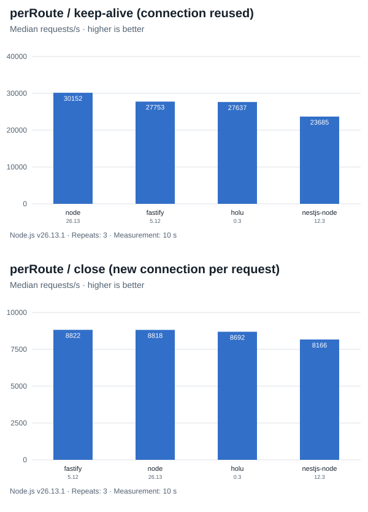

# Node.js framework benchmarks

HTTP throughput and process startup benchmarks for Express, Fastify, Koa, Hapi,
Holu, and NestJS with its Node, Express, and Fastify adapters. A plain `node:http`
server provides a baseline. All applications are TypeScript compiled to ESM.

## Latest published result

<!-- benchmark:latest:start -->

Measured: 2026-11-12T22:19:43.246Z · Node.js v26.13.1 · Mode: all.



[Full report](results/published/2026-11-12T22-19-43.246Z/summary.md) · [Raw results and environment](results/published/2026-11-12T22-19-43.246Z/run.json) · [All published results](results/published/)

<!-- benchmark:latest:end -->

## Install and check

Use the exact Node.js version in `.nvmrc` and npm version in `package.json`:

```bash
nvm install
nvm use
npm install --global npm@11.20.0
npm ci
npm run check
```

`check` runs TypeScript, ESLint, Prettier, tests, and smoke checks for every
supported framework/scenario/profile combination. Smoke checks verify status,
body, content type, connection reuse, missing routes, and process shutdown. They
do not require `wrk`. CI runs these checks without publishing performance rankings
from shared runners.

```bash
npm run build
npm run typecheck
npm run lint
npm run format
npm test
npm run smoke
```

## Run benchmarks

Install [`wrk`](https://github.com/wg/wrk) separately (for example,
`sudo apt install wrk` on Ubuntu). A short verification run:

```bash
npm run bench -- --frameworks node,nestjs,holu --duration 2 --warmup 1 --repeats 2
```

`--frameworks nestjs` selects all three NestJS adapters: `nestjs-node`,
`nestjs-express`, and `nestjs-fastify`. Use an adapter's full name to select only
that implementation. Combining `nestjs` with individual adapters runs each adapter
once.

The default experiment uses all frameworks, both connection profiles, the `perRoute`
scenario, 5 repetitions, a 5-second warmup and a 30-second measurement, 4 wrk
threads and 100 connections. It takes approximately one hour. Each repetition
gets a fresh process. Cases run sequentially in a reproducibly shuffled order;
`--seed` controls that order. The preflight HTTP request runs before warmup and
measurement. Compilation is outside measured startup.

```bash
npm run bench -- --help
npm run bench -- --mode startup --repeats 10
npm run bench -- --frameworks holu,nestjs-node,nestjs-express,nestjs-fastify --scenarios perRoute,perRequest
npm run bench -- --profiles keep-alive --duration 30 --warmup 5 --repeats 5 --threads 4 --connections 100
```

Options accept integer seconds for `--duration` and `--warmup`; zero warmup is
supported. `--startup-timeout-ms` defaults to 15000. `--wrk` selects an executable.
Unknown frameworks, scenarios, profiles, and invalid numeric parameters fail
before starting servers. Before running, the CLI lists included and skipped
frameworks for each selected scenario. These lists cover only frameworks selected
by `--frameworks`. Unsupported framework/scenario pairs are skipped and recorded;
a selection with no supported pairs fails with the same selection details.

## Scenarios and HTTP profiles

| Scenario     | Endpoint  | Implementations              | Meaning                                                                     |
| ------------ | --------- | ---------------------------- | --------------------------------------------------------------------------- |
| `perRoute`   | `/hello`  | All                          | Plain handler; Holu route-scoped controller and NestJS singleton controller |
| `perRequest` | `/hello2` | Holu and all NestJS adapters | A controller created per request                                            |

`perRoute` is the default scenario. The historical names `hello` and `request`
remain accepted aliases for `perRoute` and `perRequest`. Regenerated charts and
summaries use the new names, including when reading historical datasets.

For `perRequest`, the benchmark includes `holu`, `nestjs-node`, `nestjs-express`,
and `nestjs-fastify`. It skips `node`, `express`, `koa`, `fastify`, and `hapi`
when selected, because this benchmark has no `perRequest` implementation for them.
The console, `summary.md`, and `chart.svg` explicitly list both groups; supported
frameworks outside the `--frameworks` selection are not added automatically.

Each process registers exactly one scenario route. The response contract is
status `200`, body `Hello, World!`, and `Content-Type: text/plain; charset=utf-8`.
Frameworks keep their native request handling. Express ETag and X-Powered-By are
disabled for both standalone Express and NestJS Express.

| Profile      | wrk request                     | Server                             |
| ------------ | ------------------------------- | ---------------------------------- |
| `keep-alive` | HTTP/1.1 persistent connections | Unlimited requests per connection  |
| `close`      | `Connection: close`             | At most one request per connection |

Every implementation binds to `127.0.0.1`, uses a 5000 ms keep-alive timeout,
1000 ms keep-alive timeout buffer, 60000 ms header timeout, and 300000 ms request
timeout. Setting `keepAliveTimeout` to zero would disable the idle timeout, not
keep-alive itself. The two profiles measure different connection workloads and
must be compared separately.

## Startup measurements

- `processReadyMs`: parent-observed elapsed time from spawning a fresh Node.js
  process to receiving its ready message after listening. Includes runtime
  startup, the shared harness, framework imports, decorators, and initialization.
- `importMs`: child-measured dynamic import of the selected implementation.
- `appInitMs`: child-measured application creation through listening, after imports.
- `firstRequestMs`: latency of the first HTTP request after readiness.
- `processFirstResponseMs`: parent-observed time from spawn through the first
  validated HTTP response, including readiness message delivery and scheduling.

These measure local process startup, not provisioning by a serverless provider or
cold disk caches. Every child imports only its selected framework. Child processes
run with `NODE_ENV=production` and empty `NODE_OPTIONS`; the controller's runtime
and installed dependencies are recorded. Throughput-only mode still records
startup diagnostics. Startup-only mode does not invoke wrk or warm up the server.

## Results

Each experiment writes `run.json`, `summary.md`, and `chart.svg` to
`results/runs/<UTC timestamp>/`. Use `--output <directory>` to choose another
directory. JSON includes raw wrk/server output, every repetition, error counts,
exact installed dependency versions, lockfile hash, runtime/OS/CPU, commit and
working-tree status, seed and workload parameters. Tables and charts are generated
from these data; framework versions are not maintained by hand.

The report shows median throughput and startup, throughput min/max, and the
median of each run's p95/p99 latency. These are not pooled latency percentiles.
Failed runs remain in JSON and are excluded from timing/rate summaries. A run
with wrk errors fails; the suite continues and exits nonzero. Reports are saved
at every step, including partial results when interrupted. Shutdown is bounded
and escalates to killing a child that does not stop gracefully.

```bash
npm run report -- results/runs/<experiment-directory>
```

Publish the latest successful result and refresh the chart and links at the top of this README:

```bash
npm run results:publish
# Optional: choose the source and/or publication name.
npm run results:publish -- results/runs/<experiment-directory>
npm run results:publish -- results/runs/<experiment-directory> <descriptive-name>
npm run results:publish -- --name <descriptive-name>
```

Both arguments are optional. Without a source, the command selects the newest
successful experiment from `results/runs/` and `results/published/`. Without a name,
it uses the measurement timestamp. An identical already published dataset is
reused, including after cloning the repository without local runs.

If no successful experiment exists, the command first runs the compact example:
Node.js, Fastify, NestJS (`platform-node`), and Holu, `perRoute`, both HTTP
profiles, 5 seconds of warmup and 10 seconds of measurement, repeated 3 times in
fresh processes. This takes about 6 minutes plus startup for the 8 cases.
This is the project's practical minimum
for an automatic illustrative comparison; the 1–2 second smoke runs are for
verification. The 10-second measurement also matches
[autocannon's default duration](https://github.com/mcollina/autocannon#usage).
Three repetitions expose some run-to-run variation; inspect the saved min/max
and use longer measurements or more repetitions when results vary substantially.
[Node.js documents why fixed warmup cannot guarantee a stable optimization state](https://nodejs.org/api/bench.html).

The result is copied into `results/published/<name>/` with its raw dataset and
regenerated reports. Commit that directory and `README.md` together, then push
them with your usual Git workflow. Existing datasets are never overwritten with
different data. A failed or interrupted example retains its local diagnostics
and does not publish results.

The README selects the newest successful published experiment by `finishedAt`
(or `startedAt` for older datasets), regardless of directory name or publication
order. Local runs remain in `results/runs/` until the publication command selects them. Incomplete,
empty, or failed experiments cannot be published with this command.

After manually adding, removing, or regenerating published data, refresh the block
with `npm run results:latest`. CI checks that it matches the published datasets.

See [results/README.md](results/README.md) for publishing complete datasets. The
root-level PNGs are historical artifacts without reproducible environment data.
Old startup figures excluded static imports and are not comparable to the new
process startup metric.

Run experiments on a quiet machine; wrk and the server share CPU when run locally.
Use the same runtime, machine, lockfile, scenario and profile for comparisons.

## Start one server manually

```bash
npm run build
npm run holu
# In another terminal:
wrk -t4 -c100 -d30s --latency http://127.0.0.1:3000/hello
```

The commands `npm run node`, `express`, `koa`, `fastify`, `hapi`, `holu`,
`nestjs-node`, `nestjs-express`, and `nestjs-fastify` start individual servers.
`PORT` defaults to 3000 (zero selects a free port), `BENCH_PROFILE` to `keep-alive`,
and `BENCH_SCENARIO` to `perRoute`. A successful start prints one `BENCH_READY` JSON
message. Startup errors exit nonzero.

```bash
BENCH_SCENARIO=perRequest BENCH_PROFILE=close PORT=3001 npm run nestjs-node
```

## Structure

- `apps/`: framework implementations and shared HTTP configuration/lifecycle helpers.
- `bench/`: target manifest, process controller, scenarios, wrk reporting, and tests.
- `results/`: datasets and generated reports.

To add a framework, implement `start(config)` returning its HTTP server and async
`close()`, then register its compiled entry path, package names and supported
scenarios in `bench/targets.mts`. The shared helpers stay outside request handling.
